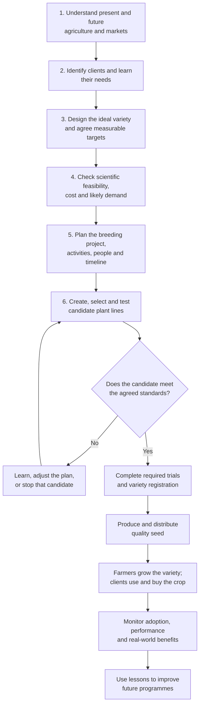
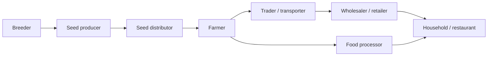

# Plant Breeding for Complete Beginners
## A step-by-step learning guide to *The Business of Plant Breeding: Market-led Approaches to New Variety Design in Africa*

**Source:** Edited by G.J. Persley and V.M. Anthony, CABI, 2017  
**Uploaded ebook:** *Business - Plant Breeding.pdf* (236 pages)  
**Audience:** A complete beginner with no formal background in agriculture, science, genetics or business.

---

# Before You Begin: What This Book Actually Teaches

This ebook is called *The Business of Plant Breeding*. It is not a basic biology textbook and it is not mainly a laboratory manual explaining every scientific method used to cross plants.

Its central subject is **demand-led plant breeding**: developing new crop varieties by understanding what farmers, seed sellers, traders, processors and consumers need, then organizing the science, testing, delivery and investment so that the resulting variety is useful and actually gets adopted.

Think of it this way:

- Plant science helps a breeder create a better plant.
- Market understanding helps the breeder decide what “better” should mean.
- Business and project planning help the new variety reach the people who need it.
- Monitoring helps everyone find out whether the variety really made a difference.

The book has seven chapters:

1. Principles of Demand-led Plant Variety Design
2. Visioning and Foresight for Setting Breeding Goals
3. Understanding Clients’ Needs
4. New Variety Design and Product Profiling
5. Variety Development Strategy and Stage Plan
6. Monitoring, Evaluation and Learning
7. The Business Case for Investment in New Variety Development

The book focuses on African agriculture, but many of its ideas apply to crop improvement in India and elsewhere.

## What is not covered in full detail

The book assumes that a plant breeder has, or works with people who have, technical knowledge of crop biology and breeding. It refers to genetics, germplasm, crossing, selection, hybrid crops, molecular tools, field trials and seed production, but does not teach all of those subjects from first principles.

This guide explains the role of those subjects when the book discusses them, but it will not pretend that the ebook contains a complete course on DNA, Mendelian genetics, pollination biology, hybrid seed production or laboratory biotechnology. A final section identifies these gaps and suggests the next subjects to learn.

## A simple running example

Throughout this guide, imagine that a team wants to develop a new tomato variety for a region.

Different people may want different things:

- A farmer may want a high harvest, disease tolerance and plants that survive local weather.
- A trader may want tomatoes that can travel without getting crushed.
- A retailer may want tomatoes that look attractive and remain fresh on the shelf.
- A restaurant may want a particular size, colour and taste.
- A household may want tasty tomatoes at an affordable price.
- A seed seller may want seed that can be produced reliably and sold at a price farmers can afford.

A successful variety must make sense across this chain. A tomato that produces a huge harvest but becomes soft before reaching the market may not be a successful commercial variety.

This is the central idea behind the book.

# The Big Picture: How a Demand-led Variety Is Developed

This is a simplified teaching diagram, not a universal technical breeding protocol. The exact scientific steps and number of years depend on the crop, breeding method, country rules, facilities and resources.

---

# Chapter 1 — Principles of Demand-led Plant Variety Design

## Lesson 1.1 — What is a crop variety?

A **crop** is a plant grown for a useful purpose. Rice, wheat, maize, tomato, chilli and brinjal are crops.

Within one crop, there can be many **varieties**. They belong to the same crop, but they differ in characteristics.

For example, two tomato varieties may differ in fruit size, shape, colour, taste, time to harvest, total yield, disease response, firmness during transport, or suitability for cooking and processing.

A variety is a particular kind or type of a crop with a recognizable combination of characteristics.

**Why this matters:** “We need a better tomato” is not yet a useful instruction for a breeder. Better in what way? Better for the farmer, retailer, processor or person eating it?

## Lesson 1.2 — What is plant breeding?

Plant breeding is the organized process of developing plant varieties with useful characteristics.

A breeder may begin with existing plant material that has different strengths. Through suitable breeding methods and repeated evaluation, the breeder tries to develop plants that combine desired characteristics.

A simple analogy is choosing useful qualities from different family lines. One tomato plant may produce tasty fruit, while another may produce more fruit or tolerate a disease better. A breeding programme tries to bring useful qualities together in a new variety.

The scientific work is essential, but this book asks an additional question:

**Are we developing the kind of plant that people actually want and can use?**

## Lesson 1.3 — What does “demand-led” mean?

“Demand-led” means that the needs and preferences of intended users help determine what the breeder should develop.

**Technology-led starting point:** “Our research team has a technique that can improve a plant characteristic. Let us develop a variety using it.”

**Demand-led starting point:** “Farmers, traders and consumers face a problem. Let us understand it, decide what a useful new variety should do, and then identify the best scientific way to develop it.”

The book does not say technology is unimportant. It says scientific innovation and market demand should work together.

### Tomato example

Suppose a research team develops a tomato with unusually large fruit. But local consumers prefer medium-sized tomatoes, and retailers find the large fruit difficult to pack. The scientific achievement may be real, but the variety may not be adopted.

A demand-led team would first investigate what different clients value, then decide whether larger fruit is actually a useful target.

## Lesson 1.4 — Who are the clients and stakeholders?

The book uses **client** broadly. It does not mean only the person who pays the breeder. Clients include people and organizations that influence the use, sale, processing or consumption of a crop.

For tomato, clients may include farmers, seed companies, seed distributors, traders, wholesalers, retailers, food processors, restaurants and household consumers.

A **stakeholder** is a person or organization that has an interest in, or can influence, the project. Government regulators, research institutions, funders and farmer organizations may be stakeholders even if they are not direct buyers of the crop.

## Lesson 1.5 — What is a crop value chain?

A **value chain** is the journey a crop takes from the original seed to the final user, including all the people and activities that add value along the way.

Each participant has different needs:

- Seed producers need seed plants that produce good-quality seed.
- Farmers need crops that perform well in the field.
- Traders need produce that survives handling and transport.
- Retailers need produce that looks good and remains saleable.
- Consumers need a product that meets expectations for taste, appearance, price and use.

If a breeder listens only to farmers, an important requirement later in the chain may be missed.

### Rice example

A farmer may prefer rice that produces a large quantity of grain. A miller may prefer grain that mills well with fewer broken pieces. A household may prefer a particular aroma, texture and cooking quality.

A variety that performs well in the field but produces grain that consumers dislike may struggle in the market.

## Lesson 1.6 — Why do improved varieties sometimes fail to spread?

The book's Executive Summary reports historical adoption estimates for modern varieties across sub-Saharan Africa: about 35% for many food crops over the period discussed, compared with about 60% in Asia and 80% in South America. These are figures reported by the 2017 book from an earlier cited study; they are not current statistics.

The book identifies several reasons why farmers may not adopt a released variety:

- Seed may not be available where farmers live.
- Seed may be too expensive.
- Farmers may not have access to credit.
- Farmers may not know about the variety.
- Farmers may be unsure whether it will perform reliably.
- Consumers or traders may not accept the crop.
- The variety may not fit local farming conditions or market needs.

**Important lesson:** Registering or releasing a variety is not the same as getting it used.

## Lesson 1.7 — Farmer-participatory breeding and demand-led breeding

Farmer-participatory breeding involves farmers in evaluating or helping shape breeding work.

Demand-led breeding includes this idea, but goes further. It also consults other clients in the value chain, including traders, processors, retailers and consumers in rural and urban areas.

The breeder does not replace scientific judgment with a popularity contest. Instead, the breeder collects information from people who will grow, sell, process or eat the crop, and combines it with technical evidence.

## Lesson 1.8 — What is a trade-off?

A **trade-off** occurs when improving one characteristic makes another characteristic harder to achieve, or when time and money do not allow every desired feature to be included.

For example, clients may request a tomato that is very large, extremely tasty, high yielding, resistant to several diseases, firm for transport and cheap to produce. It may not be technically or financially realistic to maximize every feature at once.

The team must decide which features are essential, which are desirable and which can be given lower priority. The book emphasizes that these choices should be discussed with clients and stakeholders.

## Lesson 1.9 — The breeder's role is broader than crossing plants

In a demand-led programme, a breeder must also coordinate people, understand the crop's market and uses, interpret market research and field data, set clear targets, plan work, work with seed businesses and public institutions, help ensure the variety reaches farmers, and measure adoption and benefits.

### Chapter 1 — Simple summary

Plant breeding is not successful merely because a new plant has been created. A successful variety must solve a real problem and be useful to the people who grow, handle, process, sell and eat the crop. Demand-led breeding starts by understanding these people and the whole value chain.

### Five things to remember

1. A crop can have many varieties, each with a different combination of characteristics.
2. Demand-led breeding starts with the needs of intended users.
3. Farmers are important clients, but they are not the only clients.
4. A value chain connects seed development, farming, handling, processing, selling and consumption.
5. A released variety is not automatically an adopted variety; seed access, affordability, awareness and acceptance matter.

### Test your understanding

1. What is the difference between a crop and a variety?
2. What does demand-led plant breeding mean?
3. Name four clients in a tomato value chain besides the plant breeder.
4. Why might a high-yielding tomato variety fail in the market?
5. What is a trade-off? Give one example.

### Real-world example

A team wants to develop a tomato for a region where fruit softens during transport. It speaks with farmers, transporters, retailers and consumers. It learns that firmness, shelf life, taste and yield all matter. The team prioritizes targets and asks breeders to develop and test a variety against them. This is demand-led variety design.

---

# Chapter 2 — Visioning and Foresight for Setting Breeding Goals

## Lesson 2.1 — Why think about the future?

Developing a new variety takes time. The book explains that breeders should consider market requirements in the period roughly 5–10 years after a variety is expected to be released.

By the time a variety is ready, weather patterns, diseases, cities, consumer preferences, transport systems, government rules and food businesses may have changed.

If the breeder designs only for today's conditions, the variety may be less useful when it reaches farmers.

**Foresight** means thinking systematically about possible future conditions before making today's decisions. It is not fortune-telling. It is preparing for more than one plausible future.

## Lesson 2.2 — Visioning and forecasting

**Visioning** is describing a desired future. A team might imagine that in ten years more farmers sell tomatoes to organized retailers, food processing expands, and water shortages become more serious.

**Forecasting** uses available information to estimate what may happen. For example, if a town's population is growing and processing businesses are expanding, demand for processing tomatoes may increase.

Forecasts can be wrong. Their purpose is to make assumptions visible and testable.

## Lesson 2.3 — The STEEP framework

The book introduces STEEP analysis. It organizes five groups of forces that may change agriculture and markets.

| Letter | Driver | Simple meaning | Tomato example |
|---|---|---|---|
| S | Social | People, lifestyles, population and preferences | More urban households want convenient food |
| T | Technological | New tools, machines and methods | Better irrigation or cold storage becomes available |
| E | Economic | Prices, income, jobs, costs and trade | Fuel prices increase transport costs |
| E | Environmental | Weather, soil, water, pests and climate | Heat stress or water shortage becomes more frequent |
| P | Policy | Government rules, programmes and regulations | New seed registration or food safety requirements |

A breeder should ask how each driver could affect the crop and the people who use it.

### Chilli example

- Social: consumers may prefer a particular heat level or colour.
- Technological: processors may adopt machines that require uniform pods.
- Economic: labour costs may rise, making easy harvesting more valuable.
- Environmental: drought or a new pest may threaten production.
- Policy: pesticide rules or seed regulations may change.

These forces may suggest new breeding priorities.

## Lesson 2.4 — What is a scenario?

A **scenario** is a believable story about one possible future. It is not a claim that the future will definitely happen.

A team could create three tomato-market scenarios:

- **Strong urban growth:** More consumers buy fresh tomatoes through supermarkets. Appearance, uniformity and shelf life become especially important.
- **Processing industry expands:** More tomatoes go to sauce and puree factories. Processing quality, colour and reliable supply become important.
- **Difficult growing conditions:** Water becomes less reliable and heat stress increases. Field performance under those conditions becomes a priority.

The team can check whether its proposed variety design would remain useful in each scenario.

## Lesson 2.5 — Predictable changes and uncertainties

Some changes are easier to anticipate than others. A planned road project may have a known schedule, although delays are possible. A sudden pest outbreak is much harder to predict. Gradual population growth may be more predictable than future consumer fashion.

The book encourages breeders to examine uncertainty and prepare ways to reduce risk.

## Lesson 2.6 — Risk analysis and risk mitigation

A **risk** is something that might happen and harm the project or reduce the usefulness of the future variety.

A **risk mitigation action** is a practical step that reduces the chance of the risk happening or reduces its damage.

| Possible risk | Why it matters | Possible response |
|---|---|---|
| Consumer preference changes | New variety may no longer match demand | Recheck preferences during development |
| Disease becomes more serious | Variety may perform poorly | Include relevant disease testing and maintain alternatives |
| Seed multiplication is difficult | Farmers may not get enough seed | Test seed production and supply requirements early |
| Registration rules do not cover a new trait | Release may be delayed | Speak with officials during design |
| A key trial season is lost | Project may be delayed | Plan backup sites, seasons or seed stocks where appropriate |

The book specifically emphasizes reviewing each important trait to see whether it is likely to remain relevant throughout the development period.

## Lesson 2.7 — Why maintain more than one promising line?

A breeding team may keep several candidate lines rather than betting everything on one. If one line fails a test, another may still succeed.

The book discusses the benefits and costs of maintaining biologically diverse germplasm lines. Keeping alternatives can reduce biological risk, but requires land, labour, testing, time and money.

## Lesson 2.8 — Use evidence, not assumptions

Foresight should be based on crop production and market statistics, population and income trends, climate information, government agricultural plans, research findings, conversations with clients and evidence from neighbouring regions.

The book stresses that breeders should understand the policy and agricultural research environment in which they work.

### Chapter 2 — Simple summary

A new variety may take years to develop, so breeders must think beyond today's market. Visioning describes a desired future; forecasting estimates possible changes; scenarios explore different plausible futures; and STEEP analysis helps organize the forces that may shape agriculture. Risk analysis helps the team prepare rather than simply hope that its assumptions remain true.

### Five things to remember

1. Design for the market and growing conditions expected when the variety is released, not only those seen today.
2. Foresight is structured thinking about possible futures, not fortune-telling.
3. STEEP means Social, Technological, Economic, Environmental and Policy drivers.
4. Scenarios help test whether a variety design remains useful under different futures.
5. Keeping alternative breeding lines and reviewing assumptions can reduce risk, although it adds cost.

### Test your understanding

1. Why might a variety designed only for today's market become unsuitable later?
2. What does STEEP stand for?
3. What is the difference between a forecast and a scenario?
4. Give one environmental and one policy risk for a rice breeding project.
5. Why might a breeding team keep several candidate lines?

### Real-world example

A team is planning a new rice variety. It expects water availability may become less reliable over the next decade, but is uncertain how quickly. It creates scenarios for normal rainfall, irregular rainfall and severe water shortage. It consults farmers and buyers, then decides which water-related performance targets deserve attention while keeping grain quality and market preferences in view.

---

# Chapter 3 — Understanding Clients' Needs

## Lesson 3.1 — Why is asking farmers not enough?

Farmers are central to crop production, but a crop travels through many hands before it reaches the final consumer. Each person may judge quality differently.

A farmer may like a maize variety because it gives a good harvest. A trader may dislike it because the grain is difficult to store. A miller may prefer a different grain size. A household may care most about taste and cooking time.

A breeder must understand the full chain, not just one link.

## Lesson 3.2 — Understand the different clients

For a rice value chain, clients may include:

- Farmers: yield, maturity time, field performance and harvest effort.
- Seed producers: seed yield, purity and ease of multiplication.
- Seed retailers: customer demand, reliable supply and sale price.
- Traders: grain appearance, storage and transport quality.
- Millers: milling recovery and low breakage.
- Retailers: packaging, appearance and shelf stability.
- Consumers: aroma, taste, texture, cooking time and price.
- Food businesses: consistent supply and qualities required for their products.

A single variety may not satisfy every client equally well. Sometimes separate varieties are needed for different market segments.

## Lesson 3.3 — What is market segmentation?

A **market segment** is a group of customers with similar needs or buying behaviour.

The tomato market might contain fresh-market tomatoes sold in local markets, premium tomatoes sold through supermarkets, tomatoes grown for sauce and puree processing, and tomatoes sold to restaurants and hotels.

These groups may value different characteristics.

Segmentation helps the team decide which groups it intends to serve, how large those groups may be, what each group values, and whether one variety can serve several groups or multiple varieties are needed.

## Lesson 3.4 — What is market research?

Market research is the systematic collection of information about what clients need, prefer, buy and are willing or able to pay for.

Useful questions include:

- What variety do you currently use?
- Why do you choose it?
- What problems do you face?
- Which qualities matter most?
- Which qualities would make you change varieties?
- What would prevent you from buying new seed?
- What price could you afford?
- Who influences your buying decision?
- What happens to the crop after harvest?

## Lesson 3.5 — Qualitative and quantitative information

**Qualitative information** describes opinions, experiences and reasons. Example: “I prefer this rice because it smells good and stays soft after cooking.”

**Quantitative information** uses numbers. Example: “The household buys 10 kg of rice each month,” or “the preferred cooking time is about 20 minutes.”

Both are important. Numbers can show how common a preference is, while conversations can explain why it exists.

## Lesson 3.6 — Methods for learning from clients

The book discusses market research and participatory appraisal methods. In simple terms, these include:

- Individual interviews.
- Group discussions.
- Surveys and questionnaires.
- Field visits and observation.
- Discussions with traders, retailers and processors.
- Consumer testing, including taste and cooking panels.
- Working with social scientists and agricultural economists.
- Using existing socio-economic studies, while checking whether they contain the information breeders need.

A method should fit the question. A consumer taste question may need a tasting session; a question about seed affordability may need interviews or a survey.

## Lesson 3.7 — Avoid leading questions

A leading question pushes a person toward the answer the interviewer wants.

Poor question: “You would surely prefer a tomato that is much bigger, wouldn't you?”

Better question: “Which tomato size do you normally buy, and why?”

Poor question: “Would you buy our new high-yielding rice?”

Better questions:
- “What rice variety do you currently buy?”
- “What do you like and dislike about it?”
- “What would make you switch?”
- “What price would be acceptable?”

The goal is to discover the truth, not collect compliments.

## Lesson 3.8 — Do not confuse what people say with what they do

Someone may say they like a new variety but may not buy its seed. They may prefer it in a tasting session but reject it when they see its price.

The book emphasizes reliable, independent information and continuing consultation. Market research should happen not only at the beginning but also during development, testing, launch and after commercialization.

## Lesson 3.9 — Rural and urban clients

The book notes that consumer preferences can differ between rural and urban settings. A rural household may value a crop for home consumption and storage. An urban consumer may place greater importance on appearance, convenience, packaging or consistency.

These are not universal rules; they are questions to investigate rather than assumptions to make.

## Lesson 3.10 — What is willingness to pay?

A person may like a product but not be willing or able to pay more for it.

For seed, the breeder and seed business need to understand whether the farmer sees enough benefit to buy the seed, whether the seed price is affordable, whether credit is available, and whether the expected harvest or selling price justifies the cost.

For harvested produce, traders and consumers may pay more for certain qualities, but this must be tested in the real market.

## Lesson 3.11 — Why market research can fail

The book warns about research based on assumptions, consulting only farmers, relying on old data, biased interviews, conducting research once and never updating it, or failing to investigate whether people can afford or access the new seed.

Poor market understanding can lead to varieties that are developed but not used, wasted investment and reduced confidence in research programmes.

### Chapter 3 — Simple summary

A breeder must understand everyone who influences the crop from seed to final use. Market segmentation identifies groups with different needs. Market research gathers reliable information about those needs, preferences, problems and buying decisions. It should be unbiased, suitable for the question and repeated during the project.

### Five things to remember

1. A client is anyone whose needs influence the variety's use, sale, processing or consumption.
2. Different clients may want different characteristics from the same crop.
3. Market segmentation groups customers with similar needs.
4. Qualitative information explains opinions and reasons; quantitative information provides numbers.
5. Good market research asks neutral questions and checks what people actually do, not only what they say.

### Test your understanding

1. Why should a rice breeder speak to millers as well as farmers?
2. What is a market segment?
3. Give one qualitative and one quantitative research question.
4. Why is “You like this new variety, don't you?” a poor research question?
5. Why should market research continue after the variety is released?

### Real-world example

A team wants to develop chilli for both fresh sale and dried chilli powder. It interviews farmers, traders, spice processors, retailers and consumers. Fresh-market buyers value appearance and freshness; processors value colour, drying behaviour and powder quality. The team discovers that one variety may not meet both markets equally well, so it considers separate product profiles for the two segments.

---

# Chapter 4 — New Variety Design and Product Profiling

## Lesson 4.1 — What is variety design?

Variety design means deciding, before the breeding work is fully under way, what the new variety should be like.

Think of building a house. You do not begin by laying bricks randomly. You first decide how many rooms it needs, how large they should be, where the doors go and what the budget allows. A breeder needs a similar design for a new variety.

## Lesson 4.2 — What is a trait?

A **trait** is a characteristic of a plant or its harvested product.

Examples include plant height, days to flowering or maturity, yield, fruit size, grain colour, taste, cooking time, disease resistance or tolerance, ability to withstand drought, firmness during transport and suitability for milling or processing.

Some traits are important mainly in the field. Others matter after harvest or at the time of eating.

## Lesson 4.3 — The product profile

The book calls the technical specification of a new variety a **product profile**. It is also called a variety design, product ideotype or variety specification.

A product profile is a detailed description of the characteristics the team wants the new variety to have. It should not merely say “Develop a high-yielding, tasty tomato.” It should describe the required traits and, wherever possible, give a measurable target.

Example of a simplified teaching profile:

| Trait | Illustrative target | Why it matters |
|---|---|---|
| Yield | At least 10% above a named benchmark in specified trials | More saleable harvest |
| Fruit firmness | Meet an agreed firmness test | Less damage during transport |
| Taste | Meet a target score in consumer tests | Consumer acceptance |
| Disease response | Meet a defined standard | More reliable production |
| Maturity | Reach harvest within a defined period | Fit local schedules |

**These numbers are illustrative only.** They are not recommendations or targets taken from the ebook. Real targets must be set using local data, suitable tests and client agreement.

## Lesson 4.4 — Why use benchmarks?

A **benchmark** is a reference point used for comparison.

Suppose the popular tomato variety in a region produces 20 tonnes per hectare under a defined trial condition. A breeding team might set a target for the new variety to exceed that result by an agreed amount, while also meeting taste and transport requirements.

Without a benchmark, words such as “high yield,” “good taste” or “long shelf life” are vague.

Benchmarks help the team answer: How good is good enough? Compared with which existing variety? Under what growing conditions? How will we measure it? What result is needed before a candidate moves forward?

The book emphasizes quantified and measurable targets rather than simply progressing the best line available at the end of a fixed period.

## Lesson 4.5 — Compare existing varieties

A breeder should understand varieties already used by farmers and the market. These may include registered commercial varieties and local farmer varieties, sometimes called landraces.

The team should learn why each is preferred or rejected. A new variety must offer a meaningful advantage or new benefit. A small improvement that no client values may not justify the cost of development.

## Lesson 4.6 — More than 40 traits may matter

The book notes that a detailed product profile may include more than 40 traits. Consider the whole tomato journey: seed germination and seed production, plant growth and field performance, flowering and fruit setting, harvesting, appearance and firmness, storage and transport, processing, cooking and eating quality.

A breeder cannot assume that yield is the only important feature.

## Lesson 4.7 — Prioritize traits

Not all traits have equal importance. Some are essential; others are desirable.

A useful beginner's classification is:

- **Must-have:** Without this, the variety is unacceptable.
- **High priority:** Strongly affects adoption or value.
- **Useful:** Adds benefit but may be negotiable.
- **Low priority:** Nice to have, but not worth major cost or delay.

This is a teaching aid, not a formal scale prescribed by the book.

Trait prioritization should consider client importance, value created, technical achievability, development time, cost, conflicts with other traits and whether the trait will still matter at release.

The book mentions decision-tree analysis as one way to handle complex and sometimes conflicting choices.

## Lesson 4.8 — Understand trade-offs

Imagine consumers want a very soft, juicy tomato, while traders want a very firm tomato that survives long transport. The team must investigate whether the desired combination is possible and what compromise, if any, is acceptable.

A breeding programme should not quietly remove an important client requirement simply because it is difficult. If a target must change, the team should use new evidence, discuss the change and check that the revised design still has demand.

## Lesson 4.9 — Product profile versus breeding objective

These are related but not the same.

- **Product profile:** Describes what the finished variety should be like.
- **Breeding objective:** Describes the specific scientific result the breeding team must achieve to deliver the profile.

Example:

- Product profile: “Rice should have preferred aroma and cook to the texture valued by target consumers.”
- Breeding objective: “Identify and develop candidate lines that meet the agreed aroma and cooking-quality tests while satisfying field-performance targets.”

The product profile describes the destination. The breeding objectives describe what the scientific team must accomplish to get there.

## Lesson 4.10 — Is the design scientifically feasible?

A wish list is not enough. The team must ask whether plant material with the required characteristics exists, whether the characteristics can be combined, whether suitable breeding methods are available, whether the traits can be measured reliably, whether the team has the people and facilities, how long the work may take, and whether seed can be produced at a practical cost.

The book refers to germplasm, crossing strategies, trait evaluation and bioassays as part of translating the profile into a workable breeding programme.

## Lesson 4.11 — What is germplasm?

**Germplasm** is plant material that can be used in breeding. It may include seeds, plants, breeding lines, varieties or other maintained plant material that carries useful characteristics.

Think of it as the breeder's collection of possible starting materials. One rice line may have useful grain quality, while another may have useful field performance. The breeder investigates whether and how those characteristics can be combined.

The ebook assumes technical knowledge of germplasm management and breeding methods; it does not teach all these biological details from the beginning.

## Lesson 4.12 — What is a bioassay?

A **bioassay** is a planned test used to measure a biological characteristic.

Examples:
- A disease test may measure how a plant responds to a disease.
- A cooking test may measure how rice behaves when cooked.
- A taste panel may score flavour or texture.
- A processing test may measure whether tomatoes are suitable for puree.

The book emphasizes that field yield trials alone may not measure all the traits clients care about. Additional tests, including consumer and processing tests, may be needed.

## Lesson 4.13 — Validate the design with clients

**Validation** means checking that the proposed product profile is realistic and wanted by the people it is intended to serve.

The team should show the profile to clients, explain the proposed characteristics and ask whether the design still solves their problems. Validation should not happen only once. As candidate lines develop, the team should bring evidence back to clients and check whether the variety remains attractive.

## Lesson 4.14 — Seed production and registration

A variety may be scientifically excellent but difficult or expensive to multiply into enough quality seed. The book therefore asks breeders to consider seed multiplication, scaling costs and future demand while designing the variety.

It also recommends early contact with variety registration officials, particularly when the new variety includes traits or quality measures that may not be covered by existing procedures.

### Chapter 4 — Simple summary

A product profile is the design specification for the new variety. It lists the characteristics clients need and gives measurable targets wherever possible. The team compares existing varieties, prioritizes traits, considers trade-offs, checks scientific and financial feasibility, validates the design with clients and plans for seed production and registration.

### Five things to remember

1. A trait is a characteristic, such as yield, taste, maturity, colour or disease response.
2. A product profile describes the desired finished variety.
3. A benchmark gives a measurable point of comparison.
4. A product profile is not the same as a breeding objective: one describes the product, the other defines the scientific work.
5. Field performance is not enough; processing, transport, cooking and consumer traits may also need tests.

### Test your understanding

1. What is a product profile?
2. Why is “high yield” not a sufficiently precise target?
3. What is the difference between a trait and a benchmark?
4. Explain the difference between a product profile and a breeding objective.
5. Why should seed production and registration be considered before the variety is ready?

### Real-world example

A rice team wants a variety for a market that values aroma, grain appearance and cooking quality. It compares popular varieties, interviews farmers, millers and consumers, and writes a product profile with agreed targets. It then checks whether the desired grain qualities can be combined with reliable field performance and whether suitable tests and seed production arrangements are available.

---

# Chapter 5 — Variety Development Strategy and Stage Plan

## Lesson 5.1 — Why does a breeding project need a plan?

A breeding project involves many people, activities, seasons, trials, decisions and expenses.

Without a plan, important tests may be forgotten, seeds may not be ready, trials may be planted too late, clients may not be consulted at the right time, registration requirements may be discovered too late, and costs may rise.

The book separates the overall strategy from the detailed stage plan and activity plan.

## Lesson 5.2 — Strategy, stage plan and activity plan

| Document | Main question | Simple example |
|---|---|---|
| Development strategy | What are we trying to deliver, why and for whom? | A tomato for fresh-market farmers and retailers |
| Stage plan | What major stages and decisions must the project pass through? | Design, early testing, advanced trials, registration, release |
| Activity plan | What specific work must happen, by whom and when? | Prepare seed, plant trial, score disease, conduct taste test |

Think of a family trip:
- Strategy: We want to visit a destination for a particular reason.
- Stage plan: Travel to the airport, fly, reach the hotel, visit locations and return.
- Activity plan: Book tickets, pack bags, arrange transport, check documents and confirm reservations.

The strategy should come before the stage plan. The stage plan organizes the work needed to deliver the strategy.

## Lesson 5.3 — What is a stage gate?

A **stage gate** is a formal decision point between stages.

At a gate, the team reviews the evidence and decides whether to continue, repeat or improve a test, change the approach if new evidence justifies it, pause the work, or stop developing a candidate line.

Imagine a tomato candidate tested for yield, fruit firmness and taste. It performs well for yield but fails the agreed taste target. The team should not automatically move it forward just because it is the best-yielding candidate. It must review the agreed product profile and decide what the evidence means.

A stage gate prevents a project from moving forward simply because time has passed.

## Lesson 5.4 — What information is needed at a gate?

Depending on the stage, evidence may include field performance, disease or stress test results, consumer or processing test results, comparison with benchmark varieties, seed availability and quality, client feedback, cost and time estimates, regulatory requirements, and unresolved risks.

The book emphasizes involving relevant clients and stakeholders at key decision points.

## Lesson 5.5 — What is a project activity plan?

The activity plan lists the actual work required to carry out the stage plan. For each activity, the team should know:

- What must be done?
- Who is responsible?
- When does it start and finish?
- What resources are needed?
- What information or result must be produced?
- Which other activity depends on it?

Some activities must happen in sequence. Others can happen at the same time.

For example, a field trial may need to identify the most promising lines before a large processing test can be conducted. But market consultations and some seed-supply planning may be possible while field trials are under way.

## Lesson 5.6 — What is the critical path?

The **critical path** is the sequence of dependent activities that determines the earliest possible completion date of the project.

Imagine these simplified tasks:

1. Select candidate lines.
2. Produce enough seed for larger trials.
3. Conduct multi-location trials.
4. Complete required performance testing.
5. Submit for registration.

If each task depends on the previous one, delaying one task delays the whole project.

Other activities may happen in parallel. The team may prepare communication materials or consult distributors while trials are running.

Critical path analysis helps identify which delays matter most and where careful management can save time.

## Lesson 5.7 — Risk management

A project risk is anything that could disrupt the work or prevent the variety from meeting its objectives.

Examples include drought or flooding at a trial site, pest outbreaks, poor seed germination, equipment failure, delayed materials, loss of a key team member, unexpected registration requirements or changed client demand.

A practical risk plan records:
1. What could go wrong?
2. How likely is it?
3. How serious would the effect be?
4. What can prevent it?
5. What will the team do if it happens?
6. Who is responsible?

The book also mentions critical control points and standard operating procedures.

A **critical control point** is a point in a process where careful checking is especially important to prevent a failure.

A **standard operating procedure (SOP)** is a written instruction describing how a repeated task should be done consistently. A seed-handling SOP, for example, might explain how seed is labelled, dried, stored and checked so samples are not mixed up.

## Lesson 5.8 — Variety registration and release

A new variety usually has to meet the rules of the country or region where it will be marketed. The exact process differs by crop and jurisdiction.

The book discusses understanding registration requirements, timelines and official procedures early. It refers to:

- **DUS:** Distinctness, Uniformity and Stability. In simple terms, the variety must be distinguishable from existing varieties, sufficiently consistent and stable in its characteristics.
- **VCU:** Value for Cultivation and Use. In simple terms, the variety must show useful value for growing and use under the relevant evaluation system.

The exact legal meaning, required trials and responsible authorities must be checked in the relevant country. The book focuses on African settings and does not provide a universal registration rule for every country.

Early communication with officials can reveal whether special consumer or processing traits need additional procedures.

## Lesson 5.9 — Getting seed to farmers

Release is not the end of the project. Farmers need access to sufficient quality seed.

The book highlights public and private seed systems, distributors, retailers and partnerships. The project should plan who will multiply seed, how seed quality will be maintained, how much seed may be required, how seed will reach remote farmers, how farmers will learn about the variety and who will respond to feedback.

### Chapter 5 — Simple summary

A development strategy explains what the team wants to deliver and for whom. The stage plan organizes the major steps and decision gates. The activity plan lists detailed work, people, resources and dates. Critical path analysis identifies tasks that control the overall timeline. Risk management and early registration planning help prevent avoidable delays. Seed delivery must be planned as part of the project.

### Five things to remember

1. Strategy, stage plan and activity plan serve different purposes.
2. A stage gate is a decision based on evidence, not simply a date on the calendar.
3. Activities may depend on one another or run in parallel.
4. The critical path identifies activities whose delay can delay the whole project.
5. Registration, seed multiplication and distribution must be considered early.

### Test your understanding

1. What is the difference between a strategy and an activity plan?
2. What decision might a team make at a stage gate?
3. Explain the critical path using a simple example.
4. What is an SOP, and why might a seed team need one?
5. Why should breeders speak with registration officials early?

### Real-world example

A maize breeding team has a promising candidate. It creates a stage plan covering seed preparation, early trials, multi-location trials, farmer evaluation, required registration tests, seed multiplication and release. Each stage has evidence requirements and named decision-makers. It also plans backup trial sites in case of severe weather.

---

# Chapter 6 — Monitoring, Evaluation and Learning

## Lesson 6.1 — Why monitor progress?

A plan tells the team what it intends to do. Monitoring checks what is actually happening.

Without monitoring, the team may discover too late that trials are behind schedule, a candidate is not meeting targets, seed multiplication is insufficient, clients have lost interest, costs are exceeding the budget, or the released variety is not being adopted.

The book describes monitoring and evaluation as part of project delivery from design through release, adoption and eventual discontinuation.

## Lesson 6.2 — What is monitoring?

**Monitoring** means regularly collecting information about activities and progress.

Examples:
- Were trials planted on time?
- Were the planned sites included?
- Was the agreed number of candidate lines tested?
- Was the budget used as planned?
- Were client consultations conducted?
- Was seed produced in the required quantity?

Monitoring is like checking the dashboard while driving. It helps the team see whether the project is following its route.

## Lesson 6.3 — What is evaluation?

**Evaluation** means judging what the information tells us about performance and results.

Examples:
- Did the candidate meet the product profile?
- Did farmers prefer it to the existing variety?
- Did it produce the expected harvest?
- Did processors find it suitable?
- Was the project worth the time and money?

Monitoring asks, “What is happening?” Evaluation asks, “How well is it working, and what does that mean?”

## Lesson 6.4 — What is learning?

Learning means using evidence and experience to improve decisions.

A tomato candidate may perform well in the field but receive poor feedback from retailers because the fruit is easily damaged. The team can learn that the original profile did not give enough importance to transport quality.

Learning should influence the current project where possible and future projects. The book also stresses learning from unsuccessful projects. A failed project should not automatically be treated as wasted effort if the team records why it failed and uses that knowledge.

## Lesson 6.5 — What are KPIs?

A **Key Performance Indicator (KPI)** is a measurable sign that tells us whether an important objective is being achieved.

A vague goal: “We want farmers to adopt the new variety.”

A more useful indicator: “Number of target farmers growing the new variety by the third season after release.”

The book says indicators should be clear, realistic, verifiable and relevant to clients and value chains.

## Lesson 6.6 — Outputs, outcomes and impacts

**Output — What the project directly produces**
- A product profile.
- Candidate lines tested.
- A variety registered and released.
- Training or promotional materials prepared.

**Outcome — What people do with the output**
- Farmers plant the variety.
- Seed retailers distribute it.
- Processors request produce from farmers.
- More land is planted with the variety.

**Impact — The wider change that results**
- Higher farm income.
- Better food availability.
- More reliable supply to processors.
- Improved opportunities for women or farming communities.
- Economic, social and environmental benefits.

A project can produce many outputs but have weak outcomes. It may register five varieties, but farmers may not plant them. That is why counting registrations alone is not enough.

## Lesson 6.7 — Examples of indicators in the book

| Area | Example indicator |
|---|---|
| Variety design | Farmer interest and support for the proposed design |
| Variety performance | Performance against the target profile |
| Variety identity | Accuracy of methods used to identify the variety |
| Release | Number of varieties registered and released |
| Adoption | Number of farmers growing the variety |
| Adoption | Area planted with the variety |
| Seed supply | Number of seed retailers distributing it |
| Value chain | Number of processors advocating its use |
| Economic impact | Increased yield or gross margin |
| Social impact | Benefits to women and farming communities |
| Project delivery | Actual cost compared with approved budget |
| Project delivery | Activities completed on time |

These are examples from the book's approach, not a mandatory list for every project.

## Lesson 6.8 — What is adoption tracking?

Adoption tracking means finding out whether intended users are actually using the new variety.

The book discusses methods that may include farmer surveys, field visits, measuring area planted, checking seed sales and distribution records, consulting processors and other value-chain clients, and using plant characteristics or molecular methods to help identify varieties.

The book refers to **phenotypic markers** and **genotypic markers**:

- A phenotypic marker is an observable plant characteristic that helps identify a variety, such as a distinctive shape or colour.
- A genotypic marker is a DNA-based feature used to identify genetic material.

The book does not teach the laboratory methods for DNA marker testing in detail.

## Lesson 6.9 — Why measure adoption after release?

A variety may be registered but never become widely used. Reasons may include unavailable or expensive seed, lack of awareness, poor performance, rejection by traders or consumers, competition from another variety, or production and market risks.

Post-release monitoring helps identify these problems and shows whether the original investment produced benefits.

The book notes that adoption tracking requires responsibility, resources and funding. It should be planned before release, not treated as optional afterward.

## Lesson 6.10 — Communicate learning

The book highlights success stories and case studies as ways to share lessons with breeders, clients, stakeholders and investors.

A useful case study records the problem, expectations, activities, results, evidence, changes for farmers and clients, and what should be done differently next time.

### Chapter 6 — Simple summary

Monitoring checks progress regularly. Evaluation judges performance and results. Learning uses evidence to improve decisions. KPIs make objectives measurable. Outputs are what the project produces, outcomes are how people use them, and impacts are the wider benefits. Adoption must be measured after release, not assumed.

### Five things to remember

1. Monitoring, evaluation and learning are connected but different activities.
2. A KPI is a measurable indicator of progress or success.
3. Outputs are not the same as outcomes or impacts.
4. The number of varieties released does not prove that farmers adopted them.
5. Post-release adoption tracking needs a plan, responsible people and funding.

### Test your understanding

1. What is the difference between monitoring and evaluation?
2. Give one output, one outcome and one impact from a rice breeding project.
3. Why is “number of varieties registered” not enough to measure success?
4. What does adoption tracking try to discover?
5. How can a failed breeding project still create useful learning?

### Real-world example

A new chilli variety is released. The project team tracks how many seed retailers stock it, how many farmers buy and plant it, how much land is planted, and whether farmers receive better returns. It also asks traders and consumers whether they like the chilli. If seed sales are strong but farmers stop planting it after one season, the team investigates why instead of declaring success based only on initial sales.

---

# Chapter 7 — The Business Case for Investment in New Variety Development

## Lesson 7.1 — Why does plant breeding need a business case?

Developing a new variety costs money. The project may need breeders and technical staff, field sites, land preparation, seed and other inputs, laboratories and testing facilities, trial travel and data collection, market research, consumer and processing tests, seed multiplication, registration, promotion, distribution and post-release monitoring.

Someone must pay: a government, research institution, donor, seed company, investor or a combination.

A **business case** explains why the proposed project is worth investing in. It shows what problem will be solved, who benefits, what it will cost, what results are expected and how realistic those expectations are.

## Lesson 7.2 — What is an investment?

An investment is money or resources put into something now in the expectation of receiving benefits later.

Plant breeding is a long-term investment. Costs often happen years before farmers can use the new variety.

Benefits may include better harvests, higher farmer income, improved crop quality, better nutrition, reliable supplies for processors, new seed businesses, more jobs or business opportunities, and social or environmental benefits.

Not all benefits are direct cash income. Some are social or environmental and may be harder to express in money.

## Lesson 7.3 — Who benefits?

The business case should identify intended beneficiaries throughout the value chain.

A new maize variety might benefit farmers through better yield or more reliable harvests; traders through grain customers want; millers through suitable grain quality; consumers through preferred food quality; seed producers through demand for quality seed; and rural communities through economic opportunities.

The book emphasizes looking beyond the breeder or research institution.

## Lesson 7.4 — Costs, benefits and return on investment

**Cost** is what the project uses or spends.  
**Benefit** is the value created by the project.  
**Return on investment (ROI)** compares the gain from an investment with what it cost.

A simple teaching formula is:

\[
ROI = \frac{\text{Benefit} - \text{Investment Cost}}{\text{Investment Cost}} \times 100
\]

### Illustrative example

Suppose a project costs ₹50 lakh to develop, test and deliver a new vegetable variety. Over the period being assessed, the estimated additional economic benefit attributable to the variety is ₹75 lakh.

\[
ROI = \frac{75 - 50}{50} \times 100 = 50\%
\]

This simplified example gives an ROI of 50%.

It is only an illustration. Real breeding investment analysis must consider the time taken to develop the variety, when benefits occur, how many farmers adopt it, area planted, changes in prices and costs, and which benefits can reasonably be attributed to the variety.

## Lesson 7.5 — Why farmer adoption changes the business case

A variety may perform brilliantly in trials, but if few farmers use it, the total benefit may be small.

Imagine two projects:
- Project A gives a large benefit per farmer, but only 100 farmers adopt it.
- Project B gives a smaller benefit per farmer, but 20,000 farmers adopt it.

Project B may create a much larger total benefit.

This is why the book says investment cases must examine assumptions about adoption, available competing varieties and development costs.

## Lesson 7.6 — What assumptions should be tested?

Important assumptions include how many farmers could use the variety, how quickly they will adopt it, whether enough seed will be available, whether seed will be affordable, whether the variety will perform as expected, whether buyers will accept the crop, whether prices will remain attractive, how much development and delivery will cost, how long benefits will continue, and whether competing varieties exist.

The book emphasizes sensitivity to factors such as farmer adoption, available variety choices and changing development costs.

## Lesson 7.7 — What is sensitivity analysis?

Sensitivity analysis asks: “What happens to the business case if one of our assumptions changes?”

| Scenario | Farmer adoption | Development cost | Possible meaning |
|---|---|---|---|
| Optimistic | High | On budget | Stronger expected return |
| Middle estimate | Moderate | On budget | More cautious return |
| Difficult | Low | Higher than planned | Return may be weak or negative |

The numbers are not estimates from the book; the table illustrates the idea.

Sensitivity analysis prevents a team from presenting only its most optimistic forecast.

## Lesson 7.8 — Economic, social and environmental benefits

The book emphasizes a broad view of benefits.

**Economic benefits:** higher farm productivity, improved profitability, lower losses, more business for seed suppliers or processors, and better value creation in the chain.

**Social benefits:** improved livelihoods, better food availability or nutrition, opportunities for women and farming communities, and greater resilience for households.

**Environmental benefits:** better adaptation to changing climate conditions, potentially more efficient resource use, and reduced vulnerability to certain production stresses.

These benefits need evidence and should not be claimed automatically. A variety only creates a benefit if it has the relevant characteristic, reaches users and performs as intended.

## Lesson 7.9 — Public and private investment

The book discusses roles for both public and private sectors.

Public research programmes may be important for crops or client groups that do not offer an immediate commercial return but matter for food security.

Private seed businesses can help with seed production, distribution, market development and long-term supply.

Partnerships can combine public research capacity with private-sector experience and delivery networks. The best arrangement depends on the crop, market, policy environment and intended beneficiaries.

## Lesson 7.10 — How to communicate a business case

A strong business case should explain:
1. The problem and opportunity.
2. The clients and beneficiaries.
3. The proposed variety and measurable targets.
4. Evidence that clients want it.
5. The technical plan and timeline.
6. The cost of development and delivery.
7. Expected economic, social and environmental benefits.
8. Risks and assumptions.
9. How adoption and impact will be measured.
10. Why this project deserves priority over other possible investments.

The book encourages a shift from seeing breeding only as a budget expense to assessing it as an investment whose results and benefits should be tracked.

### Chapter 7 — Simple summary

A business case explains why a new variety deserves investment. It identifies the problem, intended beneficiaries, costs, expected benefits, risks and assumptions. A good case considers how many farmers may adopt the variety and whether the benefits justify the cost. It also includes social and environmental outcomes, not just direct financial returns.

### Five things to remember

1. Plant breeding requires investment long before a variety reaches farmers.
2. A business case explains why the project is worth funding.
3. Adoption strongly affects the total benefits created.
4. Sensitivity analysis tests what happens when assumptions change.
5. The value of a breeding programme should be judged by benefits and use, not just the number of varieties released.

### Test your understanding

1. What is a business case?
2. Name four types of cost in a breeding programme.
3. Why does farmer adoption matter to return on investment?
4. What does sensitivity analysis test?
5. Give one economic, one social and one environmental benefit that a new variety might create.

### Real-world example

A research institute proposes a new wheat variety for a region with recurring heat stress. It estimates the cost of breeding, field trials, registration and seed delivery. It consults farmers, millers and seed businesses to estimate likely demand. It prepares optimistic, middle and difficult adoption scenarios, explains the risks and presents the evidence to government and potential funders.

---

# Putting the Seven Chapters Together: One Complete Worked Example

## A hypothetical project: A market-ready tomato for local farmers

This example brings together the book's seven chapters. It is illustrative, not a real breeding recommendation or a claim that the book provides these exact tomato targets.

### Step 1 — Understand the problem (Chapter 1)

Farmers report losses because tomatoes soften during transport. Retailers want fruit that remains attractive. Consumers want good taste. The team decides that the project must consider the entire value chain.

### Step 2 — Think about the future (Chapter 2)

The team examines population growth, changing retail channels, transport costs, weather trends, pests and government rules. It develops scenarios for fresh-market growth, processing-market growth and more difficult growing conditions.

### Step 3 — Research the clients (Chapter 3)

The team interviews farmers, traders, retailers, processors and consumers. It uses neutral questions and records both opinions and measurable information. It discovers that the fresh market and processing market have different requirements.

### Step 4 — Design the variety (Chapter 4)

The team creates a product profile for the fresh market. It lists yield, firmness, taste, maturity, disease response and other relevant traits. It compares existing varieties and sets measurable benchmarks. It checks whether the targets can be achieved and tested.

### Step 5 — Plan the work (Chapter 5)

The team prepares a strategy, stage plan and detailed activity plan. It assigns responsibilities, dates, budgets and decision gates. It plans field trials, client testing, registration and seed multiplication. It identifies risks and backup actions.

### Step 6 — Measure progress and learn (Chapter 6)

The team checks whether candidate lines meet the targets. It records trial results, client feedback, costs and delays. After release, it tracks seed distribution, farmer adoption, planted area and benefits.

### Step 7 — Justify the investment (Chapter 7)

The team estimates development and delivery costs and likely benefits to farmers and other clients. It tests different adoption assumptions and explains risks to funders. After release, actual adoption and benefits are compared with the original case.

---

# Important Comparisons and Terms

## 1. Traditional breeding, demand-led breeding and technology-led innovation

The ebook is primarily about demand-led variety design. It does not provide a complete technical comparison of all breeding methods. This table compares the starting point and decision-making emphasis.

| Approach | Starting point | Main question |
|---|---|---|
| Conventional or traditional breeding programme (as contrasted in the book) | Breeding priorities and available scientific opportunities, often with emphasis on incremental improvement | Which lines perform best under the programme's selection criteria? |
| Technology-led innovation | A new scientific method or technology | What can this technology make possible? |
| Demand-led variety design | Needs of clients and markets, combined with scientific feasibility | What variety is needed, for whom, and how can we develop and deliver it? |

These approaches need not be enemies. The book explicitly argues for balancing demand-led approaches with technology and innovation push. New technology can create opportunities clients have not yet requested, while market research helps ensure that innovation creates useful value.

## 2. Traditional varieties, improved varieties and hybrids

The ebook discusses improved varieties, germplasm and breeding programmes, but it does not teach the biology of all seed types in depth. The following is supplementary beginner background.

- **Traditional or local variety:** A variety maintained and used by farmers over time, often valued for local adaptation, taste or cultural use.
- **Improved variety:** A variety developed or selected through a breeding programme to improve one or more useful characteristics.
- **Hybrid variety:** A variety produced by crossing selected parent lines to obtain a particular combination of characteristics. In many crops, hybrid seed gives strong and relatively uniform performance in the first generation, but saved seed may not reliably reproduce the same performance in the next generation.
- **Open-pollinated variety:** A variety that can generally be maintained through seed, provided it is grown and selected in a way that maintains its identity and avoids unwanted crossing.
- **Clonal or vegetatively propagated variety:** A type maintained using plant parts such as cuttings, tubers or suckers rather than ordinary seed. Examples of crops commonly propagated this way include potato, cassava and banana.

A hybrid is not simply another word for “improved.” A variety can be improved without being a hybrid. Whether a hybrid is suitable depends on the crop, production system, seed supply and economics.

## 3. Essential vocabulary

| Term | Beginner-friendly meaning |
|---|---|
| Crop | A plant grown for food, fibre, feed or another useful purpose |
| Variety | A particular type of a crop with its own combination of characteristics |
| Trait | A characteristic, such as yield, taste, colour or maturity |
| Breeder | A person who develops or improves crop varieties |
| Germplasm | Plant material used or preserved for breeding |
| Selection | Choosing plants or lines with desired characteristics |
| Cross | Combining the reproductive material of selected parent plants |
| Candidate line | A possible new variety being tested |
| Benchmark | A reference used to judge performance |
| Product profile | The specification of what the new variety should be like |
| Breeding objective | A measurable scientific goal needed to deliver the product profile |
| Value chain | The people and activities involved from seed to final use |
| Market segment | A group of customers with similar needs |
| Validation | Checking that a design or assumption is supported by evidence and accepted by intended users |
| Bioassay | A test used to measure a biological characteristic |
| Stage gate | A formal decision point between project stages |
| Critical path | The sequence of dependent tasks that determines the earliest project completion |
| KPI | A measurable indicator of progress or success |
| Adoption | Actual use of a variety by farmers or other intended users |
| ROI | A comparison of the benefits or gain with the cost of an investment |
| DUS | Distinctness, Uniformity and Stability testing |
| VCU | Value for Cultivation and Use testing |

---

# What the Ebook Covers — and What It Does Not Teach in Full

The source book is a professional guide to the business and management of demand-led plant breeding. It connects variety design, market research, scientific feasibility, project delivery, adoption and investment.

It does **not** provide a complete beginner's course in plant biology or a step-by-step laboratory manual. The following topics are mentioned or assumed in places, but need separate learning resources for full understanding.

| Subject | Coverage in this ebook | What a beginner should study next |
|---|---|---|
| Basic plant structure and growth | Assumed background; not taught as a full introductory course | Roots, stems, leaves, flowers, fruits, seeds and plant life cycles |
| Plant reproduction and pollination | Not taught in full | Self-pollination, cross-pollination, pollen, fertilization and seed formation |
| DNA, genes and chromosomes | Not taught as a foundational course | DNA, genes, chromosomes, inheritance and variation |
| Mendelian genetics | Not a full teaching topic | Dominant and recessive traits, segregation and inheritance patterns |
| Plant crossing methods | Referenced in breeding strategy context | Parent selection, controlled crossing, pollination and seed handling |
| Selection methods | Referenced, but not comprehensively taught | Mass selection, pure-line selection, pedigree selection and recurrent selection |
| Hybrid breeding and hybrid seed production | Not explained as a complete technical subject | Inbred lines, hybrid vigour, parent-line maintenance and hybrid seed production |
| Molecular breeding and biotechnology | Mentioned as tools and emerging technologies | DNA markers, marker-assisted selection, genomic selection and relevant biotechnology concepts |
| Detailed seed production | Discussed as a delivery and scaling consideration | Seed classes, isolation, rouging, seed certification, germination and storage |
| Indian variety registration and seed law | The book focuses on African contexts | Current Indian rules, authorities and crop-specific requirements |
| Detailed farm economics | Business case principles are covered; a full farm-budgeting course is not | Cost of cultivation, gross margin, farm-gate price, market risk and farm budgets |

**Important:** Do not assume that every new variety is a hybrid, that every improved variety requires farmers to buy new seed every season, or that a variety successful in one location will perform the same way everywhere.

---

# A Beginner's Learning Roadmap After This Book

To understand plant breeding from biological foundations through commercial delivery, study these subjects in order:

1. **Plant basics:** Parts of a plant, flowering, pollination, seed formation and plant growth.
2. **Genetics basics:** DNA, genes, chromosomes, inheritance and variation.
3. **Plant reproduction:** Self-pollinated crops, cross-pollinated crops and vegetatively propagated crops.
4. **Breeding foundations:** Germplasm, parent selection, crossing, selection and evaluation.
5. **Breeding approaches:** Traditional selection, hybrid breeding, backcrossing, mutation breeding and modern molecular approaches.
6. **Field testing:** Experimental plots, replication, locations, seasons, yield measurement and disease evaluation.
7. **Seed systems:** Seed multiplication, quality, certification, storage, distribution and farmer access.
8. **Demand-led design:** Practise building a product profile for one crop using the seven chapters in this guide.
9. **Business and market:** Client research, value chains, costs, adoption, investment and impact.

---

# Final Review: The Seven Ideas That Hold the Book Together

1. **Start with people and problems.** Understand who will grow, sell, process and eat the crop.
2. **Look ahead.** A variety takes time to develop, so consider how markets, climate, technology and policy may change.
3. **Describe the desired product clearly.** Convert vague wishes into prioritized traits and measurable benchmarks.
4. **Check feasibility.** A desired characteristic must be biologically achievable, measurable and affordable.
5. **Plan the whole journey.** Organize the stages, activities, people, costs, risks, registration and seed delivery.
6. **Measure real use.** A released variety is not a success merely because it has been registered; adoption and performance matter.
7. **Treat breeding as an investment.** Compare costs with realistic economic, social and environmental benefits.

The central lesson of *The Business of Plant Breeding* is:

> A successful new variety is not simply a plant that a breeder can create. It is a plant that solves a real problem, meets the needs of its intended users, can be produced and delivered, is adopted, and creates benefits that justify the effort and investment.

---

## Source and scope note

This guide is based primarily on the Executive Summary and seven chapters of:

*The Business of Plant Breeding: Market-led Approaches to New Variety Design in Africa*, edited by G.J. Persley and V.M. Anthony, CABI, 2017.

The crop examples and beginner analogies are teaching illustrations, not experimental results from the book. The section comparing seed and breeding types is explicitly supplementary background because the ebook is not a full technical textbook on genetics or breeding methods. Historical statistics are identified as figures reported by the 2017 book and should not be treated as current estimates.

For practical breeding, seed production, variety registration or investment decisions, use current crop-specific research, local regulations and advice from qualified agricultural professionals.
